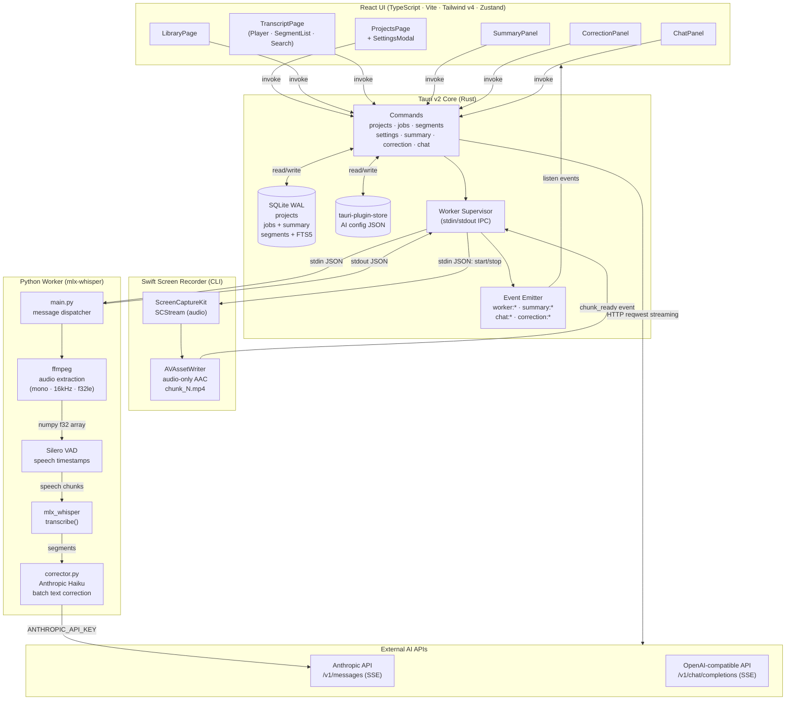
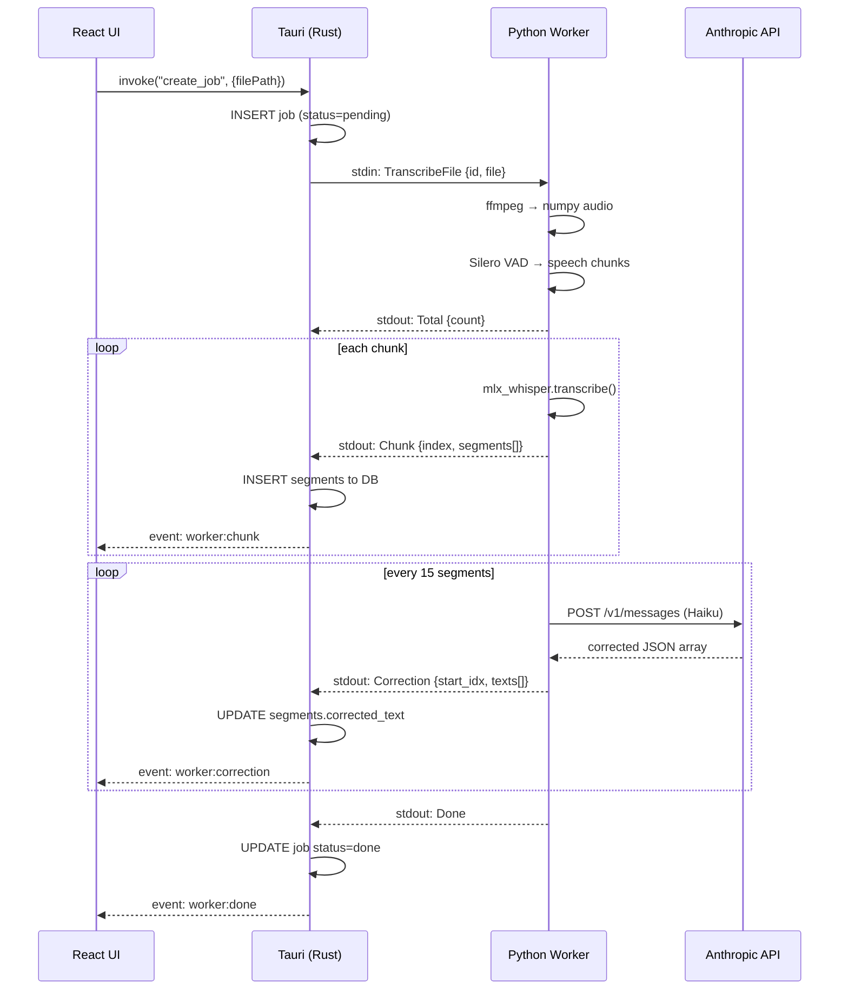
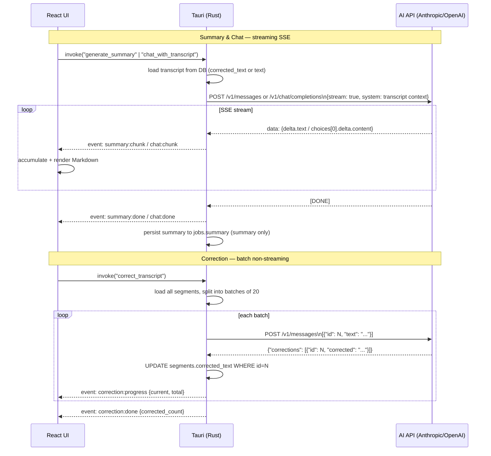
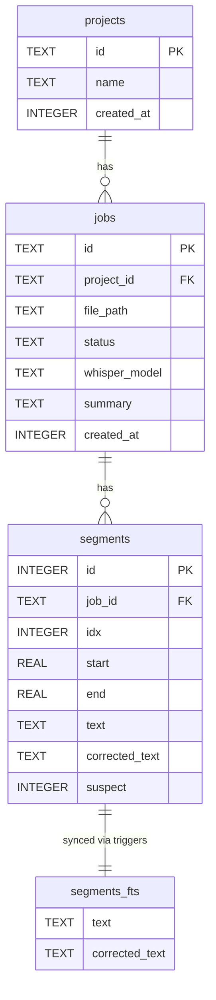

# mtt — Meet-to-Text

Local-first desktop app for transcribing meeting videos and working with transcripts using AI.

Built with Tauri v2 · React · Rust · Python (mlx-whisper)

---

## Features

### Live Recording
- Record any window directly from the app (ScreenCaptureKit)
- Real-time transcription — each 30-second chunk is transcribed as it records
- Audio-only capture (AAC 48kHz stereo) piped to Whisper in real time
- Requires Screen Recording permission + Tauri app codesigned with `com.apple.security.screen-capture`

### Transcription
- Transcribe video files locally using mlx-whisper (Apple Silicon)
- VAD (Voice Activity Detection) via silero for accurate segment splitting
- Inline segment editing — double-click to correct text

### Transcript View
- Resizable split panel: video player + transcript side by side
- Segment scroll-highlight synced to video playback
- Custom video controls: play/pause, skip ±10s, seek, volume, speed (0.5×–2×)
- Closed Captions overlay with font size S/M/L
- Full transcript view with copy to clipboard
- Search transcript — full-text search with FTS5, click result to seek video

### AI Features (requires API key)
| Feature | Description |
|---|---|
| **✨ Summarize** | Summarize with preset prompts (General Summary / Action Items), streaming output, saved per job |
| **🪄 Improve text** | Batch-correct all segments via LLM using ID-based matching, with optional custom instruction |
| **💬 Chat** | Ask questions about the transcript in a streaming chat interface |

Supports **Anthropic**, **OpenAI**, and any **OpenAI-compatible** provider (LiteLLM, custom gateways).

---

## Architecture

### Overview



### Transcription Data Flow



### AI Features Data Flow



### SQLite Schema



## Setup

### Prerequisites
- macOS 13+ (Apple Silicon)
- Rust, Node.js, pnpm, Swift (Xcode CLI tools), ffmpeg
- Python 3.11+ with a venv at `transcription-worker/.venv`

```bash
brew install ffmpeg
xcode-select --install
```

### Install

```bash
make install   # installs Python deps + builds screen-recorder binary
pnpm install   # installs JS deps
```

### Dev

```bash
pnpm tauri dev
```

### Build

```bash
pnpm tauri build
```

---

## AI Settings

Open Settings (⚙️ in Projects header) to configure:

- **Provider**: Anthropic / OpenAI / Custom (LiteLLM, internal gateways)
- **API Key**
- **Base URL** (Custom only — e.g. `https://your-gateway.com/v1`)
- **Model** — fetch available models with "Fetch models" button, or type manually
- **Test Connection** — validates key and endpoint before use

---

## Known Limitations

- Thai segment splitting not supported (`word_timestamps` causes syllable-level tokenization issues with mlx-whisper)
- Export (.srt / .txt) not yet implemented
- Whisper model selector not yet implemented (model hardcoded)
- CC settings (on/off, font size) do not persist across sessions
- Live recording saves video on **macOS 15+** via `SCRecordingOutput`; macOS 13/14 is audio-only (see Known Issues)

---

## Known Issues

### macOS 15 (Sequoia): VideoToolbox hardware encoder fails in subprocess context

**Symptom:** `AVAssetWriter.append()` fails immediately with `AVFoundationErrorDomain/-11800` wrapping `NSOSStatusErrorDomain/-16122` (`kVTVideoEncoderMalfunctionErr`). Both video and audio appends fail, even though `startWriting()` returns true.

**Root cause:** On macOS 15, the VideoToolbox HEVC/H.264 hardware encoder fails asynchronously immediately after `startWriting()` when called from a CLI subprocess (screen-recorder is spawned by the Tauri app with only `com.apple.security.screen-capture` entitlement). The writer transitions to `.failed` (status 3) before the first frame arrives, causing all subsequent appends to fail with the same error.

**Things that do NOT fix it:** switching codec (H.264 ↔ HEVC), changing pixel format (BGRA → 420v), rounding dimensions to even numbers, adding compression properties (`AVVideoExpectedSourceFrameRateKey`, etc.).

**Current fix (audio-only chunks):** Removed video input from `AVAssetWriter` entirely — no VT session, no async failure. AAC audio encoding works fine. The Whisper pipeline is unaffected since it only needs audio.

**Video recording (macOS 15+):** `SCRecordingOutput` is used alongside the audio-only chunk pipeline. Apple's framework handles all encoding internally, bypassing VideoToolbox entirely. This produces a complete `recording.mp4` (video+audio) saved at the end of the recording. On macOS 13/14, the fallback is audio-only chunks concatenated with ffmpeg.

**Architecture with SCRecordingOutput:**
```
SCStream
  ├── SCRecordingOutput → recording.mp4  (video+audio, for playback — macOS 15+)
  └── AudioHandler → AVAssetWriter → chunk_N.mp4 → Whisper  (real-time transcription)
```
